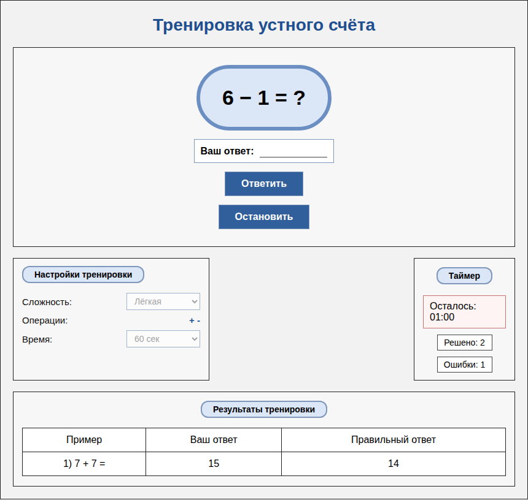

# Тренажёр устного счёта

Браузерный тренажёр арифметики: решайте примеры на время, выбирайте сложность и разбирайте ошибки. Виджет реализован на **JavaScript и Web Components** с изоляцией стилей через Shadow DOM. Серверная часть и сборка не нужны.



[Мобильный интерфейс](docs/preview-mobile.png) · [Исходный макет](widget.png)

## Возможности

- Три уровня сложности и тренировки на 30, 45, 60 или 90 секунд.
- Ответы по кнопке или клавише Enter.
- Количество отправленных ответов и ошибок, таблица последних пяти ошибок.
- Несколько независимых экземпляров на одной странице.
- Сохранение настроек и результатов в localStorage при наличии доступа.
- Адаптация для узких экранов.

| Уровень | Операции | Генерация чисел |
| --- | --- | --- |
| Лёгкий | Сложение, вычитание | Операнды от 1 до 10 |
| Средний | Сложение, вычитание, умножение | Операнды от 1 до 20 |
| Сложный | Все четыре операции | Для +, −, ×: от 1 до 50; при делении делитель и ответ от 1 до 10 |

Вычитание всегда даёт неотрицательное число, деление — целое. Результат и делимое могут превышать диапазон генерации отдельных операндов.

## Локальный запуск

Из корня проекта запустите статический сервер (требуется Python 3):

```bash
python3 -m http.server 8000 --bind 127.0.0.1
```

Откройте http://127.0.0.1:8000. Для остановки нажмите Ctrl+C в терминале.

Страницу нужно открывать через HTTP: прямое открытие index.html через file:// может блокировать загрузку data.json.

## Как пользоваться

1. Выберите сложность и длительность.
2. Нажмите «Начать», введите ответ и нажмите Enter или «Ответить».
3. После завершения посмотрите счётчики и таблицу ошибок.

«Решено» означает число всех отправленных ответов, включая неправильные. Правильных ответов = «Решено» − «Ошибки». «Остановить» завершает текущую попытку; новый старт обнуляет её результаты. Настройки недоступны во время тренировки. После обновления страницы сохраняются настройки и результаты, но тренировка автоматически не возобновляется.

## Встраивание на другую страницу

Скопируйте папку widget и подключите скрипт один раз:

```html
<script src="widget/app.js" defer></script>
<mental-math-widget
  id="practice-1"
  data-level="easy"
  data-duration="60"
  data-css="widget/app.css">
</mental-math-widget>
```

| Атрибут | Значение |
| --- | --- |
| `id` | Уникальный постоянный идентификатор для независимого сохранения |
| `data-level` | `easy`, `medium`, `hard`; по умолчанию `easy` |
| `data-duration` | `30`, `45`, `60`, `90`; по умолчанию `60` |
| `data-css` | Путь к стилям относительно HTML-страницы; по умолчанию `widget/app.css` |

Сохранённые настройки имеют приоритет над начальными атрибутами. Без id виджет работает без сохранения. Не повторяйте id: ключи localStorage зависят от него. Атрибуты читаются при первом подключении элемента; динамическое изменение атрибутов не поддерживается.

## Структура

```text
index.html       Точка входа
app.js           Страница описания и три примера виджета
data.json        Описание и пользовательские истории
style.css        Стили страницы
widget/app.js    Web Component и логика тренировки
widget/app.css   Изолированные стили виджета
widget.png       Исходный макет
tests/           Браузерные регрессионные тесты
docs/            Отчёт проверки
```

## Автоматические тесты

Проверка 20 октября 2026: **12 тестов прошли** в Chromium (Linux / Docker).

Требуется Node.js 20+ с npm. Зависимости нужны только для тестирования:

```bash
npm install
npx playwright install chromium --only-shell
npm test
```

Тесты сами запускают временный локальный HTTP-сервер и браузер. Они проверяют арифметику, независимость виджетов, историю ошибок, сохранение, таймер, повреждённое хранилище и мобильную ширину. Результаты проверки и ограничения описаны в [docs/verification.md](docs/verification.md).

## Ограничения

Это учебный клиентский проект. Нет аккаунтов, синхронизации между устройствами и долговременного журнала всех тренировок. localStorage привязан к браузеру и адресу сайта; если он заблокирован или заполнен, тренировка работает только в памяти. Фоновые вкладки могут обновлять отображение таймера с задержкой, но оставшееся время вычисляется по времени окончания. Изменение системных часов может повлиять на отсчёт.

## Происхождение

Проект подготовлен из исходного архива KCR. Сохранены структура Web Component, генератор задач и учебные пользовательские истории. Исправления перечислены в отчёте проверки.
